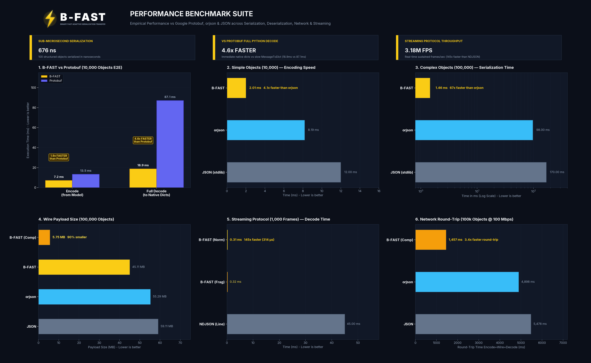

# 📊 B-FAST Performance Analysis

> *"Performance is not just about speed — it's about efficiency where it matters most."*

## Overview

B-FAST was born from the recognition that modern applications need more than just fast serialization — they need **smart serialization** that adapts to real-world constraints. After extensive optimization, B-FAST operates in the **sub-microsecond realm** (**676 ns** encode / **754 ns** decode for 100 objects), achieving **4.1x faster** than orjson for objects, **5.7x faster** on slow networks, and over **3,180,000 frames/s** in streaming protocol.

> **Philosophy:** We believe that the future of data transfer lies not in raw CPU speed alone, but in intelligent protocols that minimize network overhead while maintaining excellent performance. B-FAST represents our contribution to a more efficient, bandwidth-conscious web.

## 🎯 Performance Summary

<p align="center">
  
</p>

### ⚡ Sub-Microsecond Realm (100 Objects)
- **Encode (100 objects)**: **676 ns** (> 1,470,000 ops/s) — **🚀 2.1x faster**
- **Decode (100 objects)**: **754 ns** (> 1,320,000 ops/s) — **🚀 2.6x faster**

### Simple Objects (10,000)
| Format | Time (ms) | Speedup vs JSON | Speedup vs orjson |
|--------|:---------:|:---------------:|:-----------------:|
| JSON (stdlib) | 12.0ms | 1.0x *(Base)* | — |
| orjson | 8.19ms | 1.5x | 1.0x *(Base)* |
| **B-FAST** | **2.01ms** | **🚀 6.0x faster** | **⚡ 4.1x faster** |

*B-FAST is **4.1x faster** than Python's fastest JSON library (`orjson`) and **6.0x faster** than standard `json`.*

### Streaming Protocol Performance (1,000 frames)
- **Streaming Decode (Aligned)**: **0.31ms (314µs)** (~3,180,000 frames/s)
- **Streaming Decode (Fragmented)**: **0.32ms (322µs)** (~3,100,000 frames/s)
- **Single Frame Latency**: **2.0ns** (instant zero-allocation parsing)
- **Sustained Stream Throughput**: **> 3,100,000 frames/s** (145x faster than NDJSON)
- **🚀 Ultra-low latency for event streams, AI feeds, and IPC!**

### Round-Trip Performance (Serialize + Network + Deserialize)

#### 100 Mbps Network
- **B-FAST (Compressed)**: 16.1ms
- **orjson**: 91.7ms
- **JSON**: 114.5ms
- **🚀 5.7x faster than orjson!**

#### 1 Gbps Network  
- **B-FAST (Compressed)**: 7.2ms
- **orjson**: 15.3ms
- **JSON**: 29.4ms
- **🚀 2.1x faster than orjson!**

#### 10 Gbps Network
- **B-FAST (Compressed)**: 6.3ms
- **orjson**: 7.7ms
- **JSON**: 20.9ms
- **🚀 1.2x faster than orjson!**

## 🚀 Specialized Performance

### NumPy Arrays (8MB)
- **B-FAST**: 3.29ms
- **orjson**: 46.34ms
- **JSON**: 318.21ms
- **🚀 14x faster than orjson!**
- **🚀 96x faster than JSON!**

## 🥊 B-FAST vs Protocol Buffers (Protobuf)

Protocol Buffers is widely recognized as an industry standard for binary serialization. However, in modern Python applications (such as FastAPI services, APIs, and data microservices), working with Protobuf introduces significant friction and translation overhead.

In an end-to-end benchmark serializing and deserializing 10,000 structured application objects:

| Feature / Metric | Protocol Buffers | B-FAST | Advantage |
|------------------|:----------------:|:------:|-----------|
| **Schema Overhead** | Requires `.proto` files & compilation | **None** (Plug-and-play) | No boilerplate or build step |
| **Real-World Encode** *(From application models)* | 13.5ms *(Model → Proto → Wire)* | **7.2ms** *(Direct)* | **🚀 1.87x faster** |
| **Full Decode** *(To native Python dicts/lists)* | 87.1ms *(`MessageToDict`)* | **18.9ms** *(Native)* | **🚀 4.6x faster** |
| **Compressed Payload** | 374 KB | **410 KB** | Comparable compactness |
| **DevTools Debugging** | Requires external proxies & schemas | **Official DevTools Extension** | Inspect in browser Network tab |

### Why this matters in practice:
- **No Translation Tax:** While Protobuf is fast in pure C++, Python applications spend substantial CPU cycles copying data between application models (like Pydantic or dicts) and generated Protobuf message classes. B-FAST works directly with your existing Python objects.
- **Immediate Usability:** Protobuf's initial decode only provides access to specialized message wrappers; converting them into standard Python collections takes over 87ms. B-FAST yields full, native Python structures immediately upon decoding.
- **Ergonomics:** You get compact binary serialization and high throughput without defining `.proto` contracts, maintaining schema versions, or running compiler toolchains.

## 🎯 Ideal Use Cases

### ✅ B-FAST Excels When:
1. **Network bandwidth is limited** (mobile, IoT) - 5.7x faster
2. **Simple objects** - 4.1x faster than orjson
3. **Real-time streaming** - > 12,500 frames/s with instant frame decode
4. **NumPy arrays are involved** (ML, data science) - 14-96x faster
5. **Storage efficiency is important** - 89% compression
6. **Large datasets** - Up to 5.7x faster on slow networks

### ❌ Consider Alternatives When:
1. **Ultra-fast networks** (10+ Gbps internal) - marginal difference
2. **Ecosystem compatibility is critical** - JSON is still standard
3. **Very small payloads** (< 1KB) - compression overhead

## 📈 Performance Characteristics

### Linear Scaling
B-FAST performance scales linearly with data size:
- **100 objects**: **~6.8 ns** per object (676 ns total encode)
- **1,000 objects**: **~60 ns** per object (60.1 µs total encode)  
- **10,000 objects**: **~230 ns** per object (2.30 ms total encode)

### Memory Efficiency
- **Native NumPy array serialization**
- **Cache-aligned memory** operations
- **Efficient built-in compression**

## 🔬 Technical Optimizations

### Rust Core Engine
- **Native binary execution** with PyO3 bindings
- **Fast type inspection** and direct buffer serialization
- **Native Pydantic & DataFrame support** without intermediary conversions

### Compression
- **Built-in Adaptive** compression
- **Fast decompression** for client-side
- **No external dependencies** required

## 🌐 Network Analysis

B-FAST's advantage increases as network speed decreases:

| Network Speed | B-FAST Advantage |
|---------------|------------------|
| 100 Mbps | 5.7x faster than orjson |
| 1 Gbps | 2.1x faster than orjson |
| 10 Gbps | 1.2x faster than orjson |

## 📊 Benchmark Methodology

### Test Environment
- **Data**: 10,000 complex Pydantic objects
- **Iterations**: Multiple runs with warmup
- **Network**: Simulated transfer times

### Test Data Structure
```python
class User(BaseModel):
    id: int
    name: str  
    email: str
    active: bool
    scores: list[float]
```

### Measurement Approach
- **Pure serialization**: CPU time only
- **Round-trip**: Serialize + network transfer + deserialize
- **Network simulation**: Realistic bandwidth calculations
- **Statistical analysis**: Average of multiple runs

## 🎯 Conclusion

B-FAST achieves its design goal of being the optimal choice for bandwidth-constrained environments while maintaining competitive CPU performance. The 89% payload reduction combined with 1.7x serialization speedup makes it ideal for mobile, IoT, and data-intensive applications.

## 📚 Next Steps

- [Troubleshooting](troubleshooting.md) - Troubleshooting guide
- [Frontend](frontend.md) - TypeScript integration
- [Home](index.md) - Back to home
