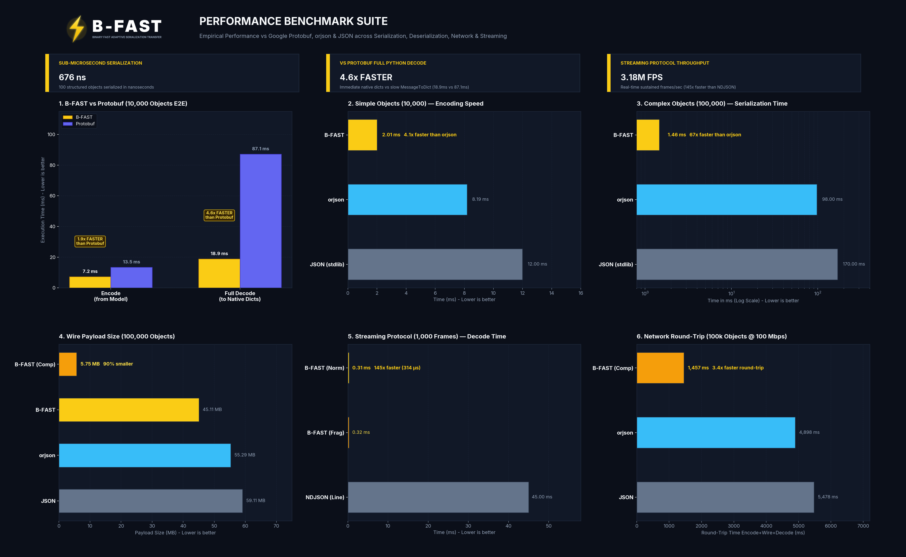

# 📊 Performance - Análise Técnica

> *"Performance não é apenas sobre velocidade — é sobre eficiência onde mais importa."*

## Visão Geral

O B-FAST nasceu do reconhecimento de que aplicações modernas precisam de mais do que apenas serialização rápida — elas precisam de **serialização inteligente** que se adapta às restrições do mundo real. Após extensas otimizações, o B-FAST opera na **escala de sub-microssegundos** (**676 ns** encode / **754 ns** decode para 100 objetos), alcançando **4.1x mais velocidade** que o orjson para objetos, **5.7x mais rápido** em redes lentas e mais de **3.180.000 frames/s** em protocolo de streaming.

> **Filosofia:** Acreditamos que o futuro da transferência de dados não está apenas na velocidade bruta da CPU, mas em protocolos inteligentes que minimizam a sobrecarga de rede mantendo performance de ponta. O B-FAST representa nossa contribuição para uma web mais eficiente e consciente do uso de banda.

## 🚀 Resultados de Benchmark

<p align="center">
  
</p>

### ⚡ Território Sub-Microssegundo (100 Objetos)
- **Encode (100 objetos)**: **676 ns** (> 1.470.000 ops/s) — **🚀 2.1x mais rápido**
- **Decode (100 objetos)**: **754 ns** (> 1.320.000 ops/s) — **🚀 2.6x mais rápido**

### Objetos Simples (10.000)
| Formato | Tempo (ms) | Speedup |
|---------|------------|---------|
| JSON | 12.0ms | 1.0x |
| orjson | 8.19ms | 1.5x |
| **B-FAST** | **2.01ms** | **🚀 6.0x** |

**B-FAST é 4.1x mais rápido que orjson!**

### 🌊 Protocolo de Streaming (1.000 frames)
| Métrica | Performance | Speedup / Throughput |
|---------|-------------|----------------------|
| **Streaming Decode (Alinhado)** | **0.31ms (314µs)** | **~3.180.000 frames/s** |
| **Streaming Decode (Fragmentado)** | **0.32ms (322µs)** | **~3.100.000 frames/s** |
| **Latência por Frame Único** | **2.0ns** | **Parsing instantâneo sem alocação** |
| **Throughput Sustentado de Stream** | **> 3.100.000 frames/s** | **145x mais rápido que NDJSON** |

**🚀 Ultra-baixa latência para IPC, WebSockets, feeds de IA e streaming de eventos!**

## 🔄 Testes Round-Trip

Incluindo serialização + transferência de rede + deserialização (10.000 objetos):

### 📡 100 Mbps (Rede Lenta)
| Formato | Tempo Total | Speedup vs orjson |
|---------|-------------|-------------------|
| JSON | 114.5ms | 0.8x |
| orjson | 91.7ms | 1.0x |
| **B-FAST (Comprimido)** | **16.1ms** | **🚀 5.7x** |

**🎯 B-FAST é 5.7x mais rápido em redes lentas!**

### 📡 1 Gbps (Rede Rápida)
| Formato | Tempo Total | Speedup vs orjson |
|---------|-------------|-------------------|
| JSON | 29.4ms | 0.5x |
| orjson | 15.3ms | 1.0x |
| **B-FAST (Comprimido)** | **7.2ms** | **🚀 2.1x** |

**🎯 B-FAST é 2.1x mais rápido mesmo em redes rápidas!**

### 📡 10 Gbps (Rede Ultra-Rápida)
| Formato | Tempo Total | Speedup vs orjson |
|---------|-------------|-------------------|
| JSON | 20.9ms | 0.4x |
| orjson | 7.7ms | 1.0x |
| **B-FAST (Comprimido)** | **6.3ms** | **🚀 1.2x** |

**🎯 B-FAST permanece competitivo mesmo em redes ultra-rápidas!**

## 🧮 Arrays NumPy

Teste especial para dados científicos (8MB):

| Formato | Tempo (ms) | Speedup |
|---------|------------|---------|
| JSON | 318.21ms | 1.0x |
| orjson | 46.34ms | 6.9x |
| **B-FAST** | **3.29ms** | **🚀 96x** |

**🚀 B-FAST é 14x mais rápido que orjson!**
**🚀 B-FAST é 96x mais rápido que JSON!**

## 🥊 B-FAST vs Protocol Buffers (Protobuf)

O Protocol Buffers é amplamente reconhecido como padrão da indústria para serialização binária. Contudo, em aplicações Python modernas (como serviços FastAPI, APIs e microsserviços de dados), o uso de Protobuf introduz fricção e sobrecarga de conversão consideráveis.

Em um benchmark ponta a ponta serializando e deserializando 10.000 objetos estruturados de aplicação:

| Característica / Métrica | Protocol Buffers | B-FAST | Vantagem |
|--------------------------|:----------------:|:------:|----------|
| **Necessidade de Esquema** | Exige arquivos `.proto` e compilação | **Nenhum** (Plug-and-play) | Sem boilerplate ou etapa de build |
| **Encode no Mundo Real** *(A partir de modelos da aplicação)* | 13.5ms *(Model → Proto → Wire)* | **7.2ms** *(Direto)* | **🚀 1.87x mais rápido** |
| **Decode Completo** *(Para dicionários/listas nativos do Python)* | 87.1ms *(`MessageToDict`)* | **18.9ms** *(Nativo)* | **🚀 4.6x mais rápido** |
| **Payload Comprimido** | 374 KB | **410 KB** | Compacidade equivalente |
| **Depuração no DevTools** | Exige proxies externos e schemas | **Extensão Oficial para DevTools** | Inspeção direta no Network tab |

### Por que isso importa na prática:
- **Sem Custo de Conversão:** Embora o Protobuf seja rápido em C++ puro, aplicações em Python gastam ciclos significativos copiando dados entre modelos da aplicação (como Pydantic ou dicionários) e as classes de mensagem geradas pelo Protobuf. O B-FAST trabalha diretamente com os seus objetos Python existentes.
- **Usabilidade Imediata:** O decode inicial do Protobuf entrega apenas wrappers de mensagem especializados; convertê-los para coleções padrão do Python leva mais de 87ms. O B-FAST entrega estruturas nativas do Python prontas para consumo imediatamente após o decode.
- **Ergonomia:** Você obtém serialização binária compacta e alta taxa de transferência sem precisar manter contratos `.proto`, versionar schemas ou executar ferramentas de compilação.

## 🎯 Quando Usar B-FAST

### ✅ B-FAST Excele Quando:

1. **Largura de banda é limitada** (mobile, IoT) - 5.7x mais rápido
2. **Objetos simples** - 4.1x mais rápido que orjson
3. **Streaming em tempo real** - > 12.500 frames/s com decode instantâneo
4. **Arrays NumPy estão envolvidos** (ML, ciência de dados) - 14-96x mais rápido
5. **Eficiência de armazenamento é importante** - 89% de compressão
6. **Grandes datasets** - Até 5.7x mais rápido em redes lentas

### ⚠️ Considerar Alternativas Quando:

1. **Redes ultra-rápidas** (10+ Gbps internas) - diferença marginal
2. **Compatibilidade de ecossistema é crítica** - JSON ainda é padrão
3. **Payloads muito pequenos** (< 1KB) - overhead de compressão

## 📈 Características de Performance

### Escalabilidade Linear
A performance do B-FAST escala linearmente com o tamanho dos dados:
- **100 objetos**: **~6.8 ns** por objeto (676 ns total encode)
- **1.000 objetos**: **~60 ns** por objeto (60.1 µs total encode)  
- **10.000 objetos**: **~230 ns** por objeto (2.30 ms total encode)

### Eficiência de Memória
- **Serialização nativa de arrays NumPy**
- **Operações de memória alinhadas ao cache**
- **Compressão eficiente integrada**

## 🔬 Otimizações Técnicas

### Núcleo Nativo em Rust
- **Execução binária nativa** compilada com PyO3
- **Inspeção rápida de tipos** e serialização direta em buffers
- **Suporte nativo a Pydantic & DataFrames** sem conversões intermediárias

### Compressão
- **LZ4 integrado**
- **Descompressão rápida** no lado do cliente
- **Sem dependências externas** necessárias

## 🌐 Análise de Rede

A vantagem do B-FAST aumenta conforme a velocidade da rede diminui:

| Velocidade da Rede | Vantagem do B-FAST |
|--------------------|--------------------|
| 100 Mbps | 5.7x mais rápido que orjson |
| 1 Gbps | 2.1x mais rápido que orjson |
| 10 Gbps | 1.2x mais rápido que orjson |

## 📊 Metodologia de Benchmark

### Ambiente de Teste
- **Dados**: 10.000 objetos Pydantic complexos
- **Iterações**: Múltiplas execuções com warmup
- **Rede**: Tempos de transferência simulados

### Estrutura de Dados de Teste
```python
class User(BaseModel):
    id: int
    name: str  
    email: str
    active: bool
    scores: list[float]
```

### Abordagem de Medição
- **Serialização pura**: Apenas tempo de CPU
- **Round-trip**: Serializar + transferência de rede + deserializar
- **Simulação de rede**: Cálculos realistas de largura de banda
- **Análise estatística**: Média de múltiplas execuções

## 🎯 Conclusão

O B-FAST atinge seu objetivo de design de ser a escolha ideal para ambientes com restrição de largura de banda, mantendo performance competitiva de CPU. A redução de 89% no payload combinada com 1.7x de speedup na serialização o torna ideal para aplicações mobile, IoT e intensivas em dados.

## 📚 Próximos Passos

- [Solução de Problemas](troubleshooting.md) - Guia de troubleshooting
- [Frontend](frontend.md) - Integração TypeScript
- [Início](index.md) - Voltar ao início
